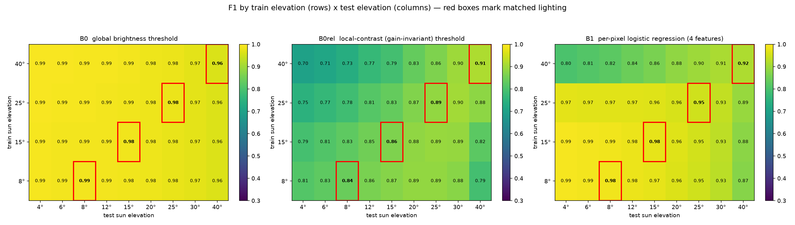

# Lunar Illumination & Shadow Algorithms

[中文](README.zh-CN.md) | **English**

> Compute and invert the illumination state of any point on the lunar surface from sunlight and shadows. Zero external data dependencies, pure NumPy, with a 29-assertion self-check and a publication-ready figure.

[](https://www.python.org/)
[](https://numpy.org/)
[](LICENSE)
[](check_lunar_shadow.py)

---

## What this is

The Moon has no atmospheric scattering: shadow boundaries are nearly step edges, and the solar elevation angle near the poles stays around 1–2° year-round. The consequence is an engineering formula with teeth:

$$L_{\text{shadow}} = \frac{h}{\tan h_s} \approx \frac{h}{\tan 1.5°} \approx 38\,h$$

**A 1 m boulder casts a shadow about 38 m long.** In the lunar polar regions, illumination is therefore not a rendering detail but a *dominant* observational and safety constraint: large areas become unobservable and untraversable simply because they lie in shadow.

This repository provides three families of algorithms (full documentation in the [algorithm guide](docs/algorithm-guide.md)):

| Family | Input → Output | Key functions |
|---|---|---|
| **A — Forward** | DEM + sun position → illumination/shadow mask | `compute_illumination()`, `horizon_map()`, `illuminate_from_horizon()` |
| **A′** | Time + lat/lon → solar azimuth/elevation | `solar_position_analytic()`, `sun_az_el_from_subsolar()` |
| **B — Inverse** | Single image → shadow mask | `image_shadow_mask()`, `illumination_invariant()` |
| **C — Measurement** | Shadow → sun angles / object height / solar geometry | `recover_sun_geometry()`, `shadow_length_to_height()`, `estimate_sun_elevation_from_shadow()` |

---

## Quick start

```bash
git clone https://github.com/HAZAKIKO/lunar-shadow-algorithms.git
cd lunar-shadow-algorithms

pip install numpy

# 1) Self-check: 29 assertions, no external data required
python check_lunar_shadow.py

# 2) Figure generation (needs matplotlib)
pip install matplotlib
python make_figure.py --n 192 --az 137 --el 6
```

Minimal usage:

```python
import lunar_shadow as ls

# Build a synthetic lunar terrain (fixed seed -> reproducible)
dem = ls.make_synthetic_lunar_dem(n=256, seed=42, relief=8.0)

# Forward: illumination mask for sun azimuth 137°, elevation 6° (1 = lit, 0 = shadowed)
illum = ls.compute_illumination(dem, az_deg=137.0, el_deg=6.0, cell=1.0)
print("shadow fraction", float((illum == 0).mean()))

# Sweeping many sun angles? Precompute a horizon map; every later query is a lookup.
Hmap = ls.horizon_map(dem, cell=1.0, n_az=72)
for az in range(0, 360, 10):
    m = ls.illuminate_from_horizon(dem, Hmap, az, el_deg=6.0, cell=1.0)

# Inversion loop: recover solar geometry from a shadow mask (coarse + local refine)
res = ls.recover_sun_geometry(dem, illum == 0, coarse_step=5.0,
                              az_step=2.0, el_step=0.5, tol=1)
print(res["az_deg"], res["el_deg"], res["score"])
```

---

## Results


| Panel | Content |
|---|---|
| (a) | Synthetic lunar DEM (fractal noise + craters with raised rims) |
| (b) | **Polar profile of the horizon angle** at the centre pixel — shows at a glance which bearing is blocked |
| (c)(d) | Shadow masks from the two independent implementations, plus **disagreeing pixels** (red); agreement 98.97% |
| (e) | **IoU heatmap** of the shadow-mask inversion (white circle = ground truth, red star = best fit) |
| (f) | **Tolerance curve** — why evaluation must use tolerance-based F1, not per-pixel IoU |

---

## Why two independent implementations

`compute_illumination()` (ray marching) and `horizon_map()` + `illuminate_from_horizon()` (horizon maps) are **two independent implementations written with completely different loop structures**. Both are kept for cross-validation: only when they agree is the geometry actually right.

| Method | Complexity | Changing sun azimuth |
|---|---|---|
| Ray marching | $O(N_{\text{step}}\cdot N_{\text{pix}})$ | must recompute |
| Horizon map | Precompute $O(N_{az}\cdot N_{\text{step}}\cdot N_{\text{pix}})$, then **$O(N_{\text{pix}})$ lookup** | **no recompute** |

**Measured cross-consistency** (192×192 synthetic terrain, `n_az=72` i.e. 5° bins): worst-case pixel agreement **97.88%**, largest shadow-fraction difference **0.87%**.

---

## What the self-check caught

The 29 assertions in `check_lunar_shadow.py` caught four real bugs during development; all are documented in the [algorithm guide §8](docs/algorithm-guide.md):

1. **Sign error in the ray-marching predicate** → flat terrain came out 100% black
2. **`np.roll` wraps around** → phantom occlusion at image borders; must be zero-padded
3. **`sun_direction(az, 90°)` used for a horizontal direction** → `cos(90°)=0` collapses the vector to zero, making the whole horizon map **silently fail** with no error
4. **Horizon-map sampling direction off by 180°** → shadows drawn on the sunlit side

Bug 4 is the one worth remembering: **this class of sign error can only be pinned down by an analytic test case.** The repository uses a north–south ridge (10 m tall) with the sun due west: the analytic horizon angle is atan(10/50) = 11.31°, and the measurement gives 11.31° west of the ridge and 0.00° east of it, with ray-marched shadows falling east of the ridge.

Two directly citable empirical results:

- **Azimuth degeneracy (an inherent limitation, not a bug)**: inverting solar geometry from a single shadow mask nails the elevation angle (Δel = 0.0°) but the top-1 and top-2 azimuths differ by only **0.002–0.009 IoU** — because cast-shadow shape is governed mainly by elevation.
- **Tolerance-based F1 is mandatory**: under an 8-pixel registration offset, tolerance-free IoU drops to 0.806 while F1(tol=3px) still holds 0.976. Per-pixel IoU measures **registration error, not detection performance**.

---

## Experiments

### Illumination generalisation for shadow segmentation

[`experiments/illumination_generalisation/`](experiments/illumination_generalisation/README.md) —
does a shadow detector trained at some sun angles still work at others?

It renders the **same terrain under many sun geometries** (cast shadow included
in the image, not just local slope), with realistic confounders: very low ambient
light, an albedo range spanning dark mare to bright highlands, and a per-image
camera gain that stands in for exposure and radiometric-calibration uncertainty.
Terrains and sun elevations are disjoint between the train and test splits.

Measured, on 160 train / 128 test samples (F1):

| model | matched lighting | shifted lighting | degradation |
|---|---|---|---|
| global brightness threshold | 0.980 | 0.981 | −0.001 |
| local-contrast (gain-invariant) threshold | 0.875 | 0.824 | +0.051 |
| per-pixel logistic regression (4 features) | 0.956 | 0.931 | +0.026 |
| DEM oracle (ceiling) | 1.000 | 1.000 | — |

Three findings worth carrying elsewhere:

1. **Elevation transfer is asymmetric.** Trained at 40° and deployed at 4°: **0.80**
   F1. Trained at 8° and deployed at 40°: **0.87**. Train at the lowest sun angles
   you can, even if you care about high ones.
2. **Higher sun angles are intrinsically harder** (B1: 0.989 at 4° → 0.939 at 30°),
   because the shadow *fraction* moves with elevation, not just the appearance.
3. **A fixed global threshold is hard to beat here**, because the airless physics
   pins shadowed pixels to a near-absolute brightness floor. Being clever about
   illumination invariance is not automatically a win — measure it.



The experiment's own first version had two silent bugs (an image that omitted the
cast shadow, and a threshold grid capped below the optimum); both are written up
in [that README](experiments/illumination_generalisation/README.md) because they
are the kind of mistake that produces plausible-looking wrong numbers.

---

## Repository layout

```
.
├── lunar_shadow.py             # All algorithms (NumPy only)
├── check_lunar_shadow.py       # Self-check: 29 assertions
├── make_figure.py              # Generates the 6-panel figure
├── lunar_shadow_figure.png     # Pre-generated figure
├── README.md                   # English (this file)
├── README.zh-CN.md             # Chinese
├── c/
│   ├── lunar_shadow.c          # C99 port of the numerical core (only -lm)
│   └── README.md               # Why a C version, build steps, verified agreement
├── docs/
│   ├── algorithm-guide.md      # Algorithm guide (English)
│   └── 算法指南.md              # Algorithm guide (Chinese)
├── experiments/
│   └── illumination_generalisation/   # paired-illumination dataset + generalisation matrices
├── tools/
│   ├── verify_c_vs_python.py   # proves the C port agrees with the Python reference
│   ├── compare_intermediates.py# finds the FIRST stage where C and Python diverge
│   ├── probe_shift.py          # measures the shift helper's sign convention
│   └── probe_ray.py            # analytic ridge checks for every sign convention
├── push-to-github.ps1          # Helper: create repo + push (requires local Git)
├── publish_via_api.py          # Helper: publish via GitHub API (no Git required)
├── verify_remote.py            # Helper: verify remote matches local (no token needed for public repos)
├── LICENSE                     # MIT
├── .gitignore
└── .gitattributes
```

### Helper scripts

| Script | Purpose |
|---|---|
| `python verify_remote.py` | Verify GitHub files match the local copy byte-for-byte (**no token needed** for public repos) |
| `python publish_via_api.py` | Create the repo and upload everything via the GitHub API when Git is unavailable (needs a fine-grained token with `Contents` and `Repository creation` set to Read and write) |
| `./push-to-github.ps1` | One-click create + push when Git is installed (browser-based auth) |

### 作者提供了不同版本以供参考 · The author provides different versions for reference

The same geometry ships in two languages, cross-checked rather than merely both present:

| Version | Where | Why it exists |
|---|---|---|
| **Python** (reference) | `lunar_shadow.py` | Read this first: full derivations, the reasoning behind every sign convention, 29-assertion self-check |
| **C99** (flight-shaped) | `c/lunar_shadow.c` | What actually runs on a radiation-hardened processor: no Python runtime, no NumPy, `-lm` and nothing else |

```bash
gcc -O2 -std=c99 -o c/lunar_shadow c/lunar_shadow.c -lm
python tools/verify_c_vs_python.py --exe c/lunar_shadow
```

Current result: **100.000% pixel agreement on the illumination mask** for both the ray-marching
and horizon-lookup paths, across four sun geometries. The one remaining divergence (horizon-map
border cells, 1.35%, which does not affect either illumination path) is documented in
[c/README.md](c/README.md) rather than hidden.

Porting to a second language earned its keep here: the C version is what exposed a sign error in
the Python `_shift_zero` helper that had been silently mirroring cast shadows. `tools/probe_ray.py`
now pins that convention against an analytic ridge answer so it cannot drift back.

> **Never commit a token**: `.gitignore` excludes `token.txt` and `publish_via_api.py` skips it explicitly.
> Use short-lived tokens and revoke them at <https://github.com/settings/personal-access-tokens>.

---

## Caveats and limitations

- **Solar position accuracy**: `solar_position_analytic()` uses a low-precision analytic method (truncated solar ecliptic longitude series + the Moon's Cassini state rotation), with typical error **0.1°–0.5°**. That is **sufficient for teaching and simulation, insufficient for mission-level planning** — use [SPICE / spiceypy](https://naif.jpl.nasa.gov/naif/toolkit.html) for the latter.
- **Not for per-pixel alignment against real imagery**: DEM-derived shadow masks are affected by resolution, interpolated elevations inside shadowed areas, and registration error. They **must not be used directly as training labels**, and evaluation must use tolerance-based metrics.
- **Known failure mode of `image_shadow_mask()`**: low-albedo materials (dark mare, dark halos, glassy pyroclastics) are misclassified as shadow. Disambiguate by checking geometric consistency against DEM-predicted shadows — and note that the pixels which are *dark in the image but predicted lit by the DEM* are precisely the promising science-target candidates.

---

## Citation

If you use this repository in your research:

```bibtex
@misc{lunar_shadow_2026,
  title  = {Lunar Illumination and Shadow Algorithms: DEM-based shadow casting, image inversion, and solar geometry recovery},
  author = {HAZAKIKO},
  year   = {2026},
  url    = {https://github.com/HAZAKIKO/lunar-shadow-algorithms}
}
```

See the [algorithm guide §9.3 and §11](docs/algorithm-guide.md) for the reference list, including the foundational works and related modern methods.

## A note at the end

The Moon has no air, so a shadow there is not a soft gradient but an edge — the terrain either
sees the Sun or it does not. This module spends most of its code on where that edge falls.

It is dedicated to *Haruhikage* — for whoever wrote the first few bars
of that opening, and for everyone who has ever had a spring they cannot go back to.

## License

[MIT](LICENSE)
