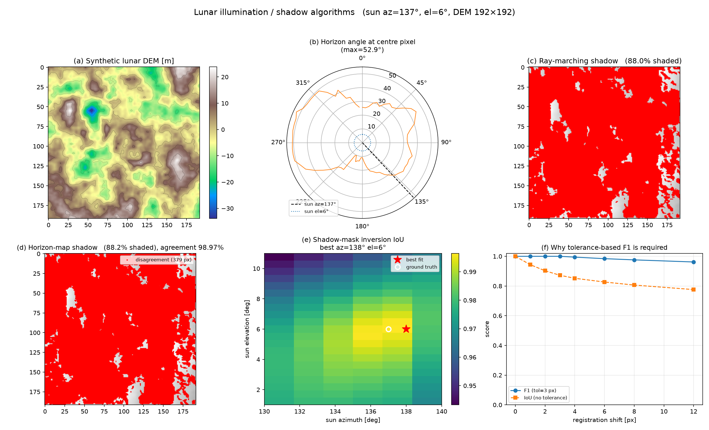

# 月面光照与阴影算法（Lunar Illumination & Shadow Algorithms）

> 根据阳光与阴影，计算与反演月面任意位置的光照状态。零外部数据依赖，纯 numpy 实现，附 29 项全部通过的自检与论文用图。

[](https://www.python.org/)
[](https://numpy.org/)
[](LICENSE)
[](check_lunar_shadow.py)

---

## 这是什么

月球没有大气散射：阴影边界是近乎阶跃的硬边，南极太阳高度角常年只有 1–2°。后果是一个极具工程意义的量级关系

$$L_{\text{shadow}} = \frac{h}{\tan h_s} \approx \frac{h}{\tan 1.5°} \approx 38\,h$$

**一块 1 m 高的石头能投出约 38 m 长的影子。** 于是在月球极区，光照与阴影不是渲染效果，而是**主导性的可观测性与安全问题**：大片区域会因为落在阴影里而无法观测、无法通行。

本仓库提供三类算法（详见 [算法指南](docs/算法指南.md)）：

| 类别 | 输入 → 输出 | 主要函数 |
|---|---|---|
| **A 正演** | DEM + 太阳位置 → 光照/阴影掩膜 | `compute_illumination()`、`horizon_map()`、`illuminate_from_horizon()` |
| **A′** | 时间 + 经纬度 → 太阳方位角/高度角 | `solar_position_analytic()`、`sun_az_el_from_subsolar()` |
| **B 反演** | 单张图像 → 阴影掩膜 | `image_shadow_mask()`、`illumination_invariant()` |
| **C 测量/重建** | 阴影 → 太阳角 / 物体高度 / 太阳几何 | `recover_sun_geometry()`、`shadow_length_to_height()`、`estimate_sun_elevation_from_shadow()` |

---

## 快速开始

```bash
git clone https://github.com/<你的用户名>/<仓库名>.git
cd <仓库名>

pip install numpy

# 1) 自检：29 项断言，确认算法与环境都正确（无需任何外部数据）
python check_lunar_shadow.py

# 2) 出图（额外需要 matplotlib）
pip install matplotlib
python make_figure.py --n 192 --az 137 --el 6
```

最小用法：

```python
import lunar_shadow as ls

# 造一块合成月面地形（固定 seed，可复现）
dem = ls.make_synthetic_lunar_dem(n=256, seed=42, relief=8.0)

# 正演：太阳方位 137°、高度 6° 时的光照掩膜（1 = 被照亮，0 = 在阴影中）
illum = ls.compute_illumination(dem, az_deg=137.0, el_deg=6.0, cell=1.0)
print("阴影占比", float((illum == 0).mean()))

# 要遍历大量太阳角？先建地平线图，之后每次换角度只需查表
Hmap = ls.horizon_map(dem, cell=1.0, n_az=72)
for az in range(0, 360, 10):
    m = ls.illuminate_from_horizon(dem, Hmap, az, el_deg=6.0, cell=1.0)

# 反演闭环：由阴影掩膜反推太阳几何（粗搜 + 邻域细搜）
res = ls.recover_sun_geometry(dem, illum == 0, coarse_step=5.0,
                              az_step=2.0, el_step=0.5, tol=1)
print(res["az_deg"], res["el_deg"], res["score"])
```

---

## 结果



| 面板 | 内容 |
|---|---|
| (a) | 合成月面 DEM（分形噪声 + 带坑缘的陨石坑） |
| (b) | 中心像素的**地平线角极坐标剖面** —— 一眼看出障碍物在哪个方位 |
| (c)(d) | 两种独立实现的阴影掩膜与**不一致像素**（红），一致率 98.97% |
| (e) | 由阴影掩膜反演太阳几何的 **IoU 热力图**（白圈=真值，红星=最优解） |
| (f) | **容差曲线** —— 论证为什么必须用容差 F1 而不是逐像素 IoU |

---

## 两个实现为什么都保留

`compute_illumination()`（射线行进）与 `horizon_map()` + `illuminate_from_horizon()`（地平线图）是**用完全不同的循环结构写的两套独立实现**。保留两套的理由是交叉验证：它们一致，才说明几何真的对了。

| 方法 | 复杂度 | 换太阳方位角 |
|---|---|---|
| 射线行进 | $O(N_{\text{step}}\cdot N_{\text{pix}})$ | 必须重算 |
| 地平线图 | 预计算 $O(N_{az}\cdot N_{\text{step}}\cdot N_{\text{pix}})$，之后 **$O(N_{\text{pix}})$ 查表** | **不用重算** |

**实测交叉一致性**（192×192 合成月面，`n_az=72` 即 5° 分箱）：最差像素一致率 **97.88%**，阴影面积占比最大差 **0.87%**。

---

## 自检抓住了什么

`check_lunar_shadow.py` 的 29 项断言在开发过程中抓出了 4 个真实 bug，全部记录在[算法指南 §8](docs/算法指南.md)：

1. **射线行进判别式方向写反** → 平坦地形 100% 全黑
2. **`np.roll` 环形回绕** → 图像边缘产生虚假遮挡，必须零填充
3. **`sun_direction(az, 90°)` 取水平方向** → `cos(90°)=0` 让向量退化成零向量，整个地平线图**静默失效**且不报错
4. **地平线图采样方向差 180°** → 阴影画到太阳同侧

第 4 个特别值得记住：**这类符号错误只能靠解析算例钉死**。仓库里用"南北向山脊（高 10 m）+ 太阳在正西"验证：解析地平角 atan(10/50) = 11.31°，实测山脊西侧 11.31°、东侧 0.00°，射线行进阴影落在山脊东侧。

两个可以直接引用的实测结论：

- **方位角简并（方法固有限制，非 bug）**：单张阴影掩膜反演太阳几何时，高度角几乎完美（Δel = 0.0°），但方位角最优与次优解的 IoU 差距只有 **0.002–0.009** —— 因为投射阴影的形状主要由高度角决定。
- **必须用容差 F1**：整体错位 8 像素时，无容差 IoU 掉到 0.806，而 F1(tol=3px) 仍有 0.976。无容差的 IoU 测的**主要是配准误差，不是检测性能**。

---

## 仓库结构

```
.
├── lunar_shadow.py            # 全部算法实现（仅需 numpy）
├── check_lunar_shadow.py      # 自检脚本：29 项断言
├── make_figure.py             # 生成 6 面板结果图
├── lunar_shadow_figure.png    # 已生成的结果图
├── docs/
│   └── 算法指南.md             # 完整算法文档：约定、公式、选型表、踩坑记录、参考文献
├── LICENSE                    # MIT
├── .gitignore
└── .gitattributes
```

---

## 使用须知与局限

- **太阳位置精度**：`solar_position_analytic()` 用的是低精度解析法（太阳视黄经简化级数 + 月球卡西尼态自转），典型误差 **0.1°–0.5°**，**足以支撑教学与仿真，不足以支撑任务级规划**。任务级请使用 [SPICE / spiceypy](https://naif.jpl.nasa.gov/naif/toolkit.html)。
- **不适用于真实影像的逐像素对齐**：DEM 算出的阴影掩膜受分辨率、阴影区高程插值误差、配准误差三重影响，**不能直接当训练标签**，评估必须用容差指标。
- **`image_shadow_mask()` 的已知失效模式**：低反照率物质（暗色月海、暗色晕、玻璃质碎屑）会被误判为阴影。消歧方法是与 DEM 预测阴影做几何一致性检验 —— 而"图像暗但 DEM 预测被照亮"的那些像素，恰恰就是潜在的科学目标候选。

---

## 引用

如果你在研究中使用本仓库，可引用：

```bibtex
@misc{lunar_shadow_2026,
  title  = {月面光照与阴影算法：基于 DEM 的阴影正演、图像反演与太阳几何重建},
  author = {<你的姓名>},
  year   = {2026},
  url    = {https://github.com/<你的用户名>/<仓库名>}
}
```

参考文献（含奠基工作与相关现代方法）见[算法指南 §9.3 与 §11](docs/算法指南.md)。

## 许可

[MIT](LICENSE)
